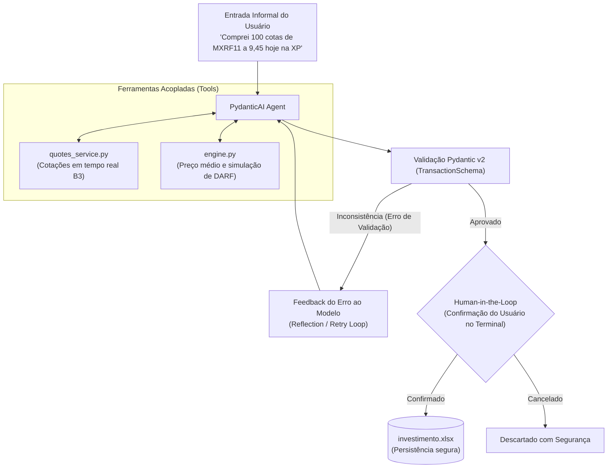

# 📈 InvestDARF • AI Copilot com PydanticAI

[](https://github.com/MatheusFrate/Invest.AI/actions)


> **Copiloto financeiro autônomo baseado em engenharia de software tradicional.** Transforma comandos informais em linguagem natural em registros de investimentos rigorosamente tipados, calcula preço médio ponderado, simula impostos de renda da B3 (DARF) e executa *loops* de auto-correção (*reflection*) para eliminar alucinações matemáticas.

---

## 💡 O Problema e a Solução

LLMs convencionais são excelentes para textos abertos, mas **falham miseravelmente em pipelines financeiros**:
* Alucinam cálculos matemáticos simples (multiplicação de cotas por preços).
* Erram formatos de datas, tickers e categorias fiscais.
* Produzem JSONs quebrados ou fora de especificação que travam bancos de dados e planilhas.

**Como este projeto resolve isso:**
Usando o **PydanticAI**, o modelo (Google Gemini ou OpenAI) opera sob contratos estritos de tipos com **validação em tempo de inferência**. Se o modelo tentar gerar um dado matematicamente contraditório, o Pydantic intercepta, devolve a mensagem de erro ao modelo e o força a corrigir o próprio raciocínio antes de qualquer dado ser persistido.

---

## 🏛️ Arquitetura do Sistema

O projeto adota uma arquitetura híbrida: o **Core Determinístico Legado** (regras fiscais e cotações) permanece isolado de alucinações, enquanto a **Camada Cognitiva do PydanticAI** traduz a linguagem natural e opera as ferramentas.



---

## ⚡ Principais Funcionalidades

1. **Extração e Tipagem Estrita (Structured Output):**
   * Transforma frases livres em objetos `TransactionSchema` validados.
   * Auto-infere o tipo de ativo (`ação`, `fii`, `etf`, `bdr`) pelo sufixo do ticker B3.
   * Auto-calcula o valor total ou unitário caso apenas um deles seja informado.
   * Normaliza datas para padrão ISO (`YYYY-MM-DD`).

2. **Loop de Auto-Correção Comprovado (Reflection / Retry):**
   * Se o usuário falar *"Comprei 10 ações a R$ 50,00 cada dando R$ 600 no total"*, o validador do Pydantic detecta que `10 * 50 != 600` e força o LLM a recalcular a conta autonomamente antes de responder.

3. **Simulador Fiscal da B3 (DARF):**
   * **Fundos Imobiliários (FIIs):** Alíquota de 20% sobre o lucro líquido (sem faixa de isenção).
   * **Ações (Mercado à Vista / Swing Trade):** Isenção total para alienações mensais $\le$ R$ 20.000,00; acima disso, alíquota de 15% sobre o ganho de capital.
   * **Prejuízos:** Imposto zero e orientação para compensação em lucros futuros da mesma classe.

4. **Human-in-the-Loop (HITL):**
   * Antes de qualquer registro ser gravado na planilha real, o terminal exibe uma tabela detalhada com os dados extraídos e exige confirmação manual do usuário `[S/n]`.

5. **Interface de Terminal Moderna (`rich`):**
   * Visualização da carteira em tempo real com cotações ao vivo via Yahoo Finance e cálculo de rentabilidade patrimonial.

---

## 📂 Estrutura do Repositório (Clean Architecture)

```text
├── .github/workflows/
│   └── ci.yml                       # Pipeline de integração contínua (GitHub Actions)
├── src/
│   └── invest_ai/                   # Pacote principal da aplicação
│       ├── core/                    # 🧠 Regras de Negócio e Domínio
│       │   └── engine.py            # Cálculo de preço médio, compensações e DARF
│       ├── services/                # 🌐 Persistência e Integrações Externas
│       │   ├── excel_handler.py     # Leitor e gravador de planilhas Excel
│       │   ├── quotes_service.py    # Coletor assíncrono de cotações B3 (Yahoo Finance)
│       │   └── dividends_service.py # Histórico de proventos e dividendos
│       ├── agent/                   # 🤖 Camada Cognitiva (PydanticAI)
│       │   ├── agent.py             # Agentes de extração e consultor fiscal
│       │   ├── deps.py              # Injeção de dependências (InvestContext)
│       │   ├── schemas.py           # Schemas Pydantic v2 e validadores estritos
│       │   └── tools.py             # Ferramentas acopladas (B3 quotes, DARF, carteira)
│       └── ui/                      # 🖥️ Interfaces com o Usuário
│           ├── desktop_app.py       # Interface Gráfica Desktop (CustomTkinter + Copiloto IA)
│           ├── base_window.py       # Componentes base de tabelas, vendas e proventos
│           └── cli.py               # Interface de Linha de Comando (Rich Terminal)
├── data/                            # 📊 Armazenamento de Dados
│   ├── investimento.xlsx            # Planilha real do usuário (bloqueada no .gitignore)
│   └── investimento_exemplo.xlsx    # Planilha de demonstração pública inclusa no Git
├── tests/                           # 🧪 Suíte de Testes Automatizados (21 testes)
│   ├── conftest.py                  # Fixtures compartilhadas e carteiras simuladas
│   ├── test_engine.py               # Testes do motor de preço médio e compensação de IR
│   ├── test_schemas.py              # Testes de tipagem e coerência matemática
│   ├── test_tools.py                # Testes de cotações e regras tributárias
│   ├── test_agent_extraction.py     # Testes de extração estruturada
│   ├── test_agent_assistant.py      # Testes de consultas analíticas e retries
│   └── test_agent_reflection.py     # Teste formal do Loop de Auto-Correção
├── main.py                          # 🚀 Ponto de entrada da Interface Gráfica Desktop
├── cli.py                           # 💻 Ponto de entrada da Interface de Terminal
├── pyproject.toml                   # Configuração moderna do pacote Python
└── requirements.txt                 # Dependências do projeto
```

---

## 🚀 Como Executar

### 1. Clonar o Repositório e Criar o Ambiente
```bash
git clone https://github.com/seu-usuario/investdarf-ai.git
cd investdarf-ai

python -m venv .venv
source .venv/bin/activate       # Linux/macOS
# ou no Windows:
.\.venv\Scripts\activate
```

### 2. Instalar as Dependências
```bash
pip install -r requirements.txt
# Ou instale diretamente:
pip install pydantic pydantic-ai python-dotenv openpyxl pandas rich pytest
```

### 3. Configurar Chaves de API (Opcional para testes locais)
Copie o arquivo de exemplo e insira sua chave da Google AI ou OpenAI:
```bash
cp .env.example .env
```
No arquivo `.env`:
```env
GEMINI_API_KEY=sua_chave_do_google_ai_studio
# ou OPENAI_API_KEY=sua_chave_openai
```
> *Nota:* Se nenhuma chave for informada, o sistema entra automaticamente em modo `TestModel` para fins de validação e CI sem custo.

### 4. Executar os Testes Automatizados
```bash
pytest -v
```
*(Todos os 21 testes devem passar em menos de 3 segundos!)*

### 5. Iniciar a Aplicação
Para abrir a **Interface Gráfica Desktop**:
```bash
python main.py
```

Para abrir a **Interface de Terminal (CLI)**:
```bash
python cli.py
```

---

## 🧪 Comprovação do Loop de Reflexão (Auto-Correção)

O teste [`tests/test_agent_reflection.py`](file:///d:/Projetos/IA/tests/test_agent_reflection.py) prova programaticamente a capacidade de auto-correção:

```python
# O modelo gera dados matematicamente inconsistentes:
args_com_erro = {"ticker": "PETR4", "quantidade": 10, "valor_unitario": 50.0, "valor_total": 600.0}

# 1. PydanticAI bloqueia: 10 * 50 != 600 -> Inconsistência matemática detectada.
# 2. O erro é injetado no prompt de feedback para o modelo.
# 3. O modelo refaz o cálculo no Turno 2 e entrega:
args_corrigidos = {"ticker": "PETR4", "quantidade": 10, "valor_unitario": 50.0, "valor_total": 500.0}
```

---

## 🔒 Segurança e Privacidade de Dados

Este projeto foi desenhado com segurança em primeiro lugar:
* O arquivo `.gitignore` bloqueia explicitamente planilhas pessoais (`investimento.xlsx`, `*.xlsx`), arquivos `.env` e executáveis de build.
* Apenas a planilha de demonstração [`investimento_exemplo.xlsx`](file:///d:/Projetos/IA/investimento_exemplo.xlsx) com dados fictícios é disponibilizada publicamente no repositório.

---

## 📜 Licença

Distribuído sob a licença **MIT**. Veja `LICENSE` para mais detalhes.
